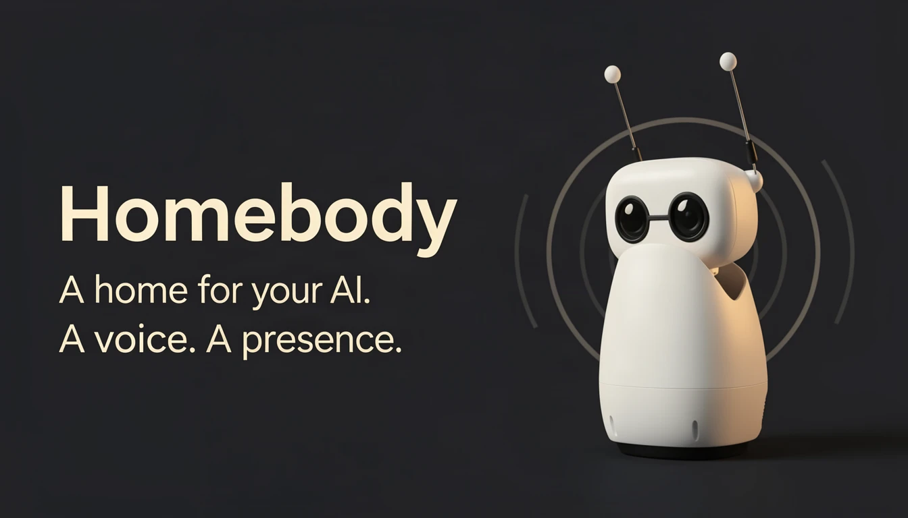
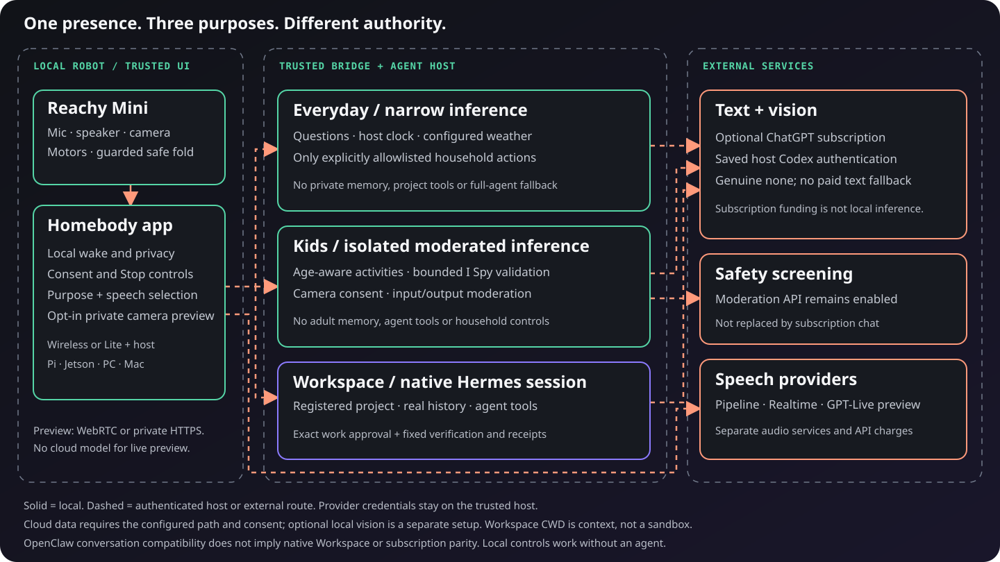

# Homebody for Reachy Mini



*AI-generated promotional illustration—not a product photograph. [Image credits](docs/IMAGE_CREDITS.md).*

**Homebody gives Reachy Mini a home:** a voice companion for everyday questions, explicitly selected project work, and supervised games and stories. The local app owns the body, dashboard, power and privacy controls; an optional private bridge connects speech providers and scoped host capabilities.

[**Explore the app page ↗**](https://huggingface.co/spaces/Timbo89/reachy_mini_homebody) · [Hardware](docs/hardware-setups.md) · [Setup](docs/agent-setup.md) · [Security](SECURITY.md) · [Contribute](CONTRIBUTING.md)

> **Early alpha.** Reference deployment is not broad hardware or production acceptance. The original Lite + Raspberry Pi 4 reference is retained; the current Lite + Jetson host has app, camera, Home Assistant, power, speaker and managed-update reference deployment. Each installation still needs supervised wake/fold, camera/privacy, speech and acoustic interruption checks. Local GPU vision, accelerated gestures, GPIO and controller support are not blanket verified on Jetson.
>
> **Release boundary:** robot release **0.5.4** includes the mode-card spacing fix and current companion source. The PR #77/#78 host support landed after 0.5.2; packaging it does not automatically configure or restart a subscription bridge or native Workspace. The reference bridge was deployed separately. Source, installed robot release and host configuration differ; see [release status](docs/release-status.md).

## Choose the purpose, then the speech engine

| Purpose mode | What it is for | Boundary |
|---|---|---|
| **Everyday** | General explanations, configured weather/time and allowlisted home controls. | Narrow host backend: no full agent, private memory, project access or full-agent fallback. |
| **Workspace** | Discuss a selected project and, after approval, run registered project work. | Native Hermes requires explicit host project/session registration and owner selection. Broker-only discussion is labelled separately. |
| **Kids** | Supervised buddy chat, stories, quizzes, riddles, calm-down time and I Spy. | Dedicated route with no adult memory or tools. Moderation, per-session I Spy camera consent and Stop/expiry/fold lifecycle remain in force. |

These are **not speech engines**. Under Advanced settings, **Pipeline** uses STT → text → TTS; **Realtime** uses OpenAI speech-to-speech; **GPT-Live preview** is an experimental speech relay. GPT-Live exposes no direct camera, movement or memory tools; delegated text follows the selected purpose boundary; physical echo cancellation and barge-in acceptance remain open. See [Everyday, Workspace and voice engines](docs/everyday-workspace.md) and [Kids Mode](docs/kids-mode.md).

Native Workspace preserves the selected Hermes session's identity and history. The planned execution flow needs exact phone approval, registered verification commands and artifact receipts; a working directory is context, **not a sandbox**. Native discussion uses the worker's configured tools, so “discuss only” is an instruction, **not enforcement**, and planned-execution approvals do not universally gate discussion tool calls. Configure owner-scoped read-only tools when that guarantee is needed. Stop speaking is distinct from Stop project work; returning to Everyday can park approved work while hiding its private display. See [native Workspace](docs/native-workspace.md).

[Hermes Agent](https://github.com/NousResearch/hermes-agent) is the native reference backend. [OpenClaw conversation compatibility](companion/README.md#use-openclaw-instead-of-or-besides-hermes) remains available, but is not native Workspace or subscription feature parity.

<a id="supported-setups"></a>

## What can I expect?

Start with the local robot, then add connected capabilities deliberately.

1. Set up [Reachy Mini Wireless](https://huggingface.co/docs/reachy_mini/platforms/reachy_mini/get_started), or a [wall-powered Lite with USB data](https://huggingface.co/docs/reachy_mini/platforms/reachy_mini_lite/get_started). For community hosts, read the [hardware guide](docs/hardware-setups.md) and [Lite + Pi 4 guide](docs/lite-raspberry-pi-4.md).
2. Install Homebody through the Reachy app dashboard. Use Reachy SDK **1.9.0+** and Python **3.11+**; managed updates have additional interpreter requirements in the [update guide](docs/managed-updates.md).
3. Open `http://REACHY_HOST:8042` on your trusted management network. Pair an owner browser using the documented pairing flow; use private trusted HTTPS for the phone PWA.
4. With clear movement space, confirm folded Standby and released torque. Try guarded Wake, one bounded look, Stop, then Standby and fold-before-torque-off. Follow [operations and acceptance](OPERATIONS.md) before enabling voice or camera paths one at a time.

The local dashboard works without an agent. Meeting and Sleep stop app microphone capture and wake detection. Camera viewing is opt-in and starts only after **Start**; the private HTTPS frame fallback has a lower frame rate than WebRTC. Newer camera lifecycle/startup repairs and safe movement controls do not replace supervised acceptance. See [robot controls](docs/robot-controls.md).

### Supported setups

Wireless, Lite + Linux/Windows PC, Lite + Mac, and community Lite + Pi/Jetson hosts have different capability and acceptance boundaries. The [hardware matrix](docs/hardware-setups.md) separates original Pi evidence, deployed Jetson core features and experimental accelerators/controllers; no whole-platform green check is implied.

### Install the Reachy app

For development from a local checkout:

```bash
uv sync --group dev
uv pip install -e .
```

Start through the Reachy dashboard. For managed appliances use the [managed-update procedure](docs/managed-updates.md), not an ad-hoc wheel swap. It updates Reachy software and dashboard assets, **not an Android APK**. Owner pairing must use the running app's user and effective `HOME`/owner database; see [browser pairing](docs/agent-setup.md#pair-your-owner-browser).

<a id="add-hermes-for-voice-memory-and-tools"></a>

## Connect speech and host capabilities

**Basic connection:** Settings → **Connect your agent** creates a one-time message for Hermes Agent or OpenClaw. Review the plan before approving it. The agent downloads the robot-served bridge, checks its manifest, creates a restricted conversation profile and pairs. [Agent-led setup](docs/agent-setup.md) explains the security model and manual alternative.

**This is not zero-setup subscription or native Workspace provisioning.** The bundle follows your *installed robot release*. It does not automatically configure saved Codex authentication, install subscription entry points or register native project sessions. Use the explicit [subscription and native setup guide](docs/subscription-reasoning.md), alongside the [companion bridge guide](companion/README.md).

Optional subscription-funded **text/vision** uses saved Hermes Codex authentication on the trusted host, without paid text API fallback. Models must genuinely accept reasoning `none`; low/minimal is not off. The validated reference configuration uses `gpt-6-sol` for Everyday, planning and native Workspace, and `gpt-6-luna` for Kids/I Spy, with reasoning `none`. These are reference choices, **not universal defaults**; `gpt-6.1-sol` currently does not support `none`.

Speech is separate: Realtime/GPT-Live and configured STT/TTS can incur API costs. Kids moderation remains an API safety-screening path; a subscription does not remove it or make the whole robot API-free. Provider credentials stay on the host, not the robot or dashboard.

## Practical guides

| Need | Start here |
|---|---|
| Host choice, power, mounting and acceptance limits | [Hardware setups](docs/hardware-setups.md) · [Lite + Pi 4](docs/lite-raspberry-pi-4.md) |
| Modes, tools, weather and speech routing | [Everyday / Workspace](docs/everyday-workspace.md) |
| Subscription text/vision and native project setup | [Subscription reasoning](docs/subscription-reasoning.md) · [Native Workspace](docs/native-workspace.md) |
| Bridge providers, restricted profiles and OpenClaw | [Companion bridge](companion/README.md) |
| Supervised child activities and data flows | [Kids Mode](docs/kids-mode.md) |
| Camera, joystick and bounded robot controls | [Robot controls](docs/robot-controls.md) |
| Silent speaker volume/mute without changing capture | [Speaker volume](docs/speaker-volume.md) |
| Release eligibility, installation and rollback | [Managed updates](docs/managed-updates.md) · [Release status](docs/release-status.md) |
| Agent-to-robot announcements/status/vision | [MCP agent access](docs/agent-access-mcp.md) |
| Home Assistant, GPIO, Bluetooth, deployment and recovery | [Operations](OPERATIONS.md) |

Home Assistant integration is opt-in, with separate controls, camera and Assist permissions. Keep its ESPHome listener on a trusted LAN and firewall it to the HA host; do not expose the plaintext device API publicly. Capability allowlists start empty. Read [security](SECURITY.md) before sharing endpoints beyond a trusted LAN/VPN.

## Architecture

[](docs/assets/architecture.svg)

*Tap or open the diagram for its full-size labels.*

The robot's lifecycle and camera permissions remain local. Everyday does not inherit Workspace authority; native Workspace is an explicit host opt-in. Camera descriptions can use an optional trusted local vision server, but local inference and accelerator performance need acceptance on your hardware.


*The [official Lite assembly preview](docs/assets/lite-assembly.webp) provides hardware context, not a Homebody acceptance result.*

*Official Pollen Robotics image, converted to metadata-free WebP under Apache-2.0. Images are explanatory, not evidence of acceptance on every setup. [Credits and immutable sources](docs/IMAGE_CREDITS.md).*

## Development and credits

```bash
uv run ruff check .
uv run pytest
uv build --wheel
reachy-mini-app-assistant check .
```

See [contributing](CONTRIBUTING.md), [changes](CHANGELOG.md), [operations](OPERATIONS.md) and [security](SECURITY.md). Homebody was previously *Reachy Mini Hermes*; [upgrade notes](OPERATIONS.md#upgrading-from-reachy-mini-hermes) preserve existing configuration.

Built by [Tim Verhoogt](https://github.com/Timverhoogt), with assistance from [Hermes Agent](https://github.com/NousResearch/hermes-agent) by [Nous Research](https://nousresearch.com/), on the work of Pollen Robotics and the Reachy Mini community. [Third-party notices](THIRD_PARTY_NOTICES.md) and [model notices](homebody/assets/THIRD_PARTY_MODELS.md) identify upstream code and models.

Apache License 2.0. See [LICENSE](LICENSE).
