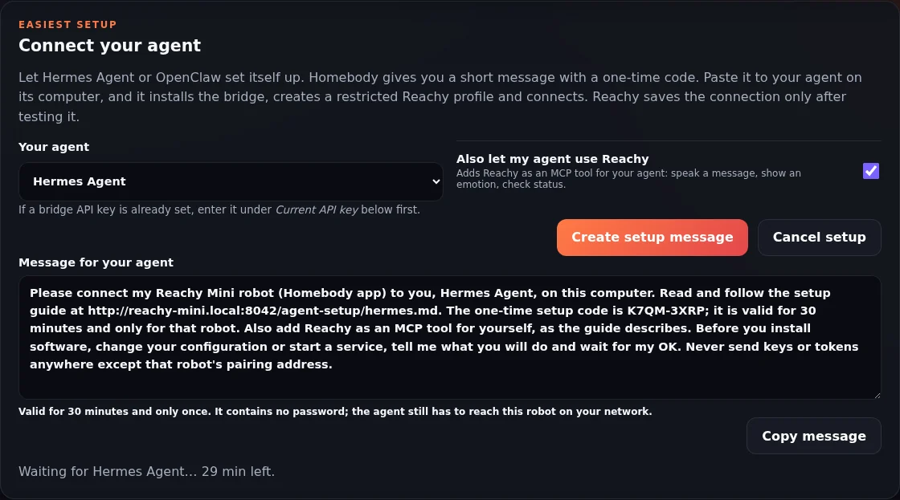

# Let your agent connect Reachy

Hermes Agent and OpenClaw can run commands on the computer they live on, so they can set up their own connection to Reachy. You copy one message from Homebody to your agent. The agent:

- installs the companion bridge;
- creates a dedicated, tool-restricted Reachy profile or agent;
- starts the bridge;
- pairs with the robot.

This automates the **basic restricted conversation connection** in [`companion/README.md`](../companion/README.md), not every current host feature. Manual setup remains available.

> **Installed-release boundary:** setup guides and bridge files come from the robot and match its installed release. Robot release **0.5.8** includes the PR #77/#78 companion source that landed after 0.5.2. Saved subscription authentication, bootstrap entry points and native-session registration still need explicit host configuration; the reference bridge was deployed separately. See [release status](release-status.md). Do not replace a newer configured host bridge with an older robot bundle without reviewing the component versions.

## Choose the setup path

- **Basic voice conversation / OpenClaw compatibility:** follow the one-time message steps below.
- **Everyday:** configure its narrow host backend and allowlists using [Everyday / Workspace](everyday-workspace.md). It has no full-agent/private-memory fallback; a restricted conversation profile is not its backend.
- **Native project Workspace:** explicitly register the project and exact Hermes session on the host, enable discussion/approved execution as needed, then select it in the paired owner UI. Native session identity/history are distinct from broker discussion. Exact phone approvals and verifier/artifact receipts gate the planned execution flow, alongside normal Hermes approvals. Native discussion still uses the worker's configured tools: “discuss only” is an instruction, **not enforcement**, and those execution approvals do not universally gate its tool calls. Configure owner-scoped read-only tools if discussion must be read-only; CWD is **not a sandbox**. Follow [native Workspace](native-workspace.md).
- **Subscription text/vision:** follow the explicit [subscription and native setup guide](subscription-reasoning.md). Agent-led pairing does not configure saved Hermes Codex auth, subscription entry points or native sessions. There is no paid text fallback. The validated reference uses `gpt-6-sol` for Everyday/planning/native Workspace and `gpt-6-luna` for Kids/I Spy with reasoning `none`; these are not universal defaults. `gpt-6.1-sol` currently does not support genuine `none`.

**Everyday / Workspace / Kids** are purpose modes, not **Pipeline / Realtime / GPT-Live preview** speech engines. Speech API costs remain separate from optional subscription text/vision; Kids moderation is retained. Kids has no adult memory/tools, and its camera consent, moderation and lifecycle do not change. Existing OpenClaw conversation support is not native Workspace or subscription parity.



## Pair your owner browser

Before changing Settings, pair the browser with the running app. On the robot host, as the app user and with the app's effective `HOME`, run:

```bash
python3 -m homebody.owner_auth pair --origin https://your-robot.example.net
```

Use your actual private trusted HTTPS origin. The CLI prints a one-time code valid for ten minutes; enter it in that browser. The owner device is remembered for thirty days. If the service uses a different `HOME` or `HOMEBODY_OWNER_DB`, use that same environment or pass `--db /path/to/the-running-app-owner-database`. A code generated in another user's database will not pair the app. Do not post pairing codes, bearer tokens or database contents publicly.

This owner-browser code is separate from the thirty-minute **Connect your agent** code below. Keep dashboard access on a trusted LAN/VPN, never an unauthenticated public port.

## How to use it

1. Install Homebody on Reachy and open its Settings page (`http://<reachy-address>:8042`).
2. Under **Connect your agent**, choose **Hermes Agent** or **OpenClaw**.
   - Tick **Also let my agent use Reachy** if your own agent should be able to make Reachy speak, show an emotion or report its status (see [agent access (MCP)](agent-access-mcp.md)).
   - If a bridge API key is already set, enter it under *Current API key* first.
3. Press **Create setup message**, then **Copy message**, and send it to your agent in the chat you normally use with it.
4. The agent explains its plan and waits for your OK, then does the work. Settings shows the progress: *Waiting for Hermes Agent…*, any problem the agent ran into, and finally *Connected to … at http://…:8643*.
5. Test the connection and configured speech provider, then try **"Hey Homebody"** under supervision. Connected is not proof of physical speech readiness or native Workspace setup.

The message looks like this:

> Please connect my Reachy Mini robot (Homebody app) to you, Hermes Agent, on this computer. Read and follow the setup guide at http://REACHY_HOST:8042/agent-setup/hermes.md. The one-time setup code is `[code from Settings]`; it is valid for 30 minutes and only for that robot. […]

## What the agent does

| Step | Hermes Agent | OpenClaw |
| --- | --- | --- |
| Reachy's own identity | A `reachy` profile, cloned from yours without messaging-bot tokens. | A `reachy` agent. |
| Tool restrictions | The profile's API server keeps only `web`, `memory` and `session_search`. Terminal, file, code, browser, delegation, cron, skills and computer-use are off. | `tools: { profile: "minimal", deny: ["gateway", "presence", "session_status"] }`, so it has no file, shell, web, presence or OpenClaw admin tools. |
| Bridge | Downloaded from the robot and checked against its SHA-256 list. Runs in Hermes' Python with `--profile reachy` on port 8643. | Downloaded and checked the same way. Runs in its own venv with `--agent-backends openclaw` on port 8643. |
| Pairing | Sends the setup code, `http://<its LAN address>:8643` and the bridge key to the robot. | Same. |
| Optional MCP | Adds Reachy to **your** profile: `mcp_servers.homebody`, with the token in `.env`. | `openclaw mcp set homebody …`, for your own agents. The `reachy` agent cannot use it. |

Your own Hermes profile or OpenClaw agents keep their tools; only the Reachy-facing side is restricted. The guides the agent follows are served by the robot itself (`/agent-setup/hermes.md`, `/agent-setup/openclaw.md`). They match the installed Homebody version, and you can read them first.

## Setup security boundaries

- **The code is the owner's permission.** Only Settings can create one, and it needs the bridge API key when one is set. It lasts 30 minutes, works once, and five wrong codes end it. The message itself contains no password.
- **Nothing is saved until it works.** Before saving, the robot calls the bridge's health check and an authenticated route with the key the agent sent. It also checks that the agent behind the bridge is ready and restricted: a Hermes profile that still exposes `terminal` or file tools is refused, with the tool names. The agent gets the exact reason and can retry with the same code.
- **The bridge is checked.** Every bridge file is compared with the robot's SHA-256 manifest before it runs. That catches incomplete or mismatched downloads; the robot remains the source to trust.
- **LAN only.** Setup routes live on the dashboard port. They are not reachable through the hosted-agent tunnel and are blocked while Kids Mode is locked.
- **The agent asks first.** The message asks it to explain its plan and wait for your OK before installing, configuring or starting anything. It also tells the agent to send keys only to the robot's pairing address.

## Historical basic-setup verification

| Agent setup | Result |
| --- | --- |
| OpenClaw 2026.9.8, fresh install, with Claude Code acting as the agent and following only the pasted message (run twice; the second run used the revised guide) | ✅ Created the `reachy` agent (minimal profile), verified and started the bridge, and paired. Reachy's own voice turns reached `agent=reachy` with no tools. The owner's `main` agent got the Homebody MCP tools; `reachy` could not call them. |
| Hermes Agent 0.19.0, fresh pip install, same method | ✅ Created the `reachy` profile and removed the cloned Telegram token. The profile kept `web`, `memory` and `session_search`. The agent installed `aiohttp` and `mcp<2`, verified and started the bridge, and paired. It added Homebody MCP to the owner's profile with the token in `.env`, and `hermes mcp test` listed the three tools. Voice turns reached the `reachy` profile, and the model saw only memory and session search. |

Both runs used a stand-in language model behind the agent. A run with your real model and voice on the robot is still open in `plan.md`.

## Troubleshooting

| Settings or the agent says | Fix |
| --- | --- |
| *Reachy could not reach the bridge* | Start the bridge with `--host 0.0.0.0`. Allow port 8643 from the robot in the computer's firewall. Use the computer's LAN address, not `127.0.0.1`. |
| *Hermes exposes broad host tools to Reachy (terminal, …)* | `hermes -p reachy tools disable --platform api_server terminal file code_execution browser delegation cronjob skills computer_use` |
| *The bridge refused that api_key* | Send the key the bridge uses: the `reachy` profile's `API_SERVER_KEY`, or `API_SERVER_KEY` in OpenClaw's `bridge.env`. |
| *That setup code is not right* / *No setup is waiting* | Create a new message in Settings. |
| OpenClaw: every turn says *internal error* | The agent has `sandbox: { mode: "all" }` but Docker is not running. Remove the sandbox line or start Docker. |
